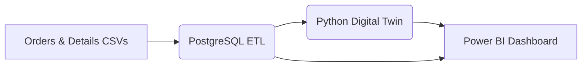

<div align="center">

# 🛒 E-Commerce Analytics & Digital Twin


**PostgreSQL** • **Python** • **Power BI**

*Turning raw retail orders into cleaned warehouse tables, Monte Carlo inventory forecasts, and interactive sales dashboards.*

</div>

---

## 💡 What This Project Does

1. **Cleans & Organizes Data (PostgreSQL):** Loads raw `Orders.csv` and `Details.csv` files, removes duplicates and nulls, and builds indexed analytical views.
2. **Simulates Inventory & Margins (Python):** Runs **500 Monte Carlo simulations** over a 12-month forecast to test pricing, demand spikes, and stockout risks.
3. **Visualizes Performance (Power BI):** Connects directly to PostgreSQL views and Python CSV outputs for interactive executive reporting.

---

## 🔄 How It Works



---

## 🧩 Project Components

<details>
<summary><b>1. 🗄️ PostgreSQL ETL & Warehouse (Click to expand)</b></summary>
<br>

A structured 9-stage SQL pipeline (`madhav_ecommerce`) that transforms raw CSVs into a star-schema warehouse:
* **Staging & Cleaning:** Loads raw text into `stg_orders` and `stg_details`, deduplicates via `ROW_NUMBER()`, validates dates/numbers, and enforces primary/foreign keys in `cleaned_orders` and `cleaned_details`.
* **Performance Indexing:** Adds B-tree, composite, and partial indexes (`profit > 0`) for fast joins and aggregations.
* **Analytical Views:**
  * `vw_order_enriched`: Master view with profit margin %, BCG quadrants, regions, and date parts.
  * `vw_monthly_kpi`: Pre-aggregated monthly sales, profit, and Month-over-Month growth.
  * `vw_customer_segments`: RFM-style customer value tiers (`Platinum`, `Gold`, `Silver`, `Bronze`).
  * `vw_product_performance`: Sub-category revenue rankings and average selling prices.

</details>

<details>
<summary><b>2. 🎲 Python Inventory & Policy Simulator (Click to expand)</b></summary>
<br>

Tests **5 business scenarios** across product categories using Poisson demand and binomial returns:

| Scenario | What Changes? | Business Goal |
| :--- | :--- | :--- |
| **`baseline`** | Current demand, pricing, and 1.10x stock cover | Benchmark performance |
| **`growth`** | +15% demand, -5% price, 1.15x stock cover | Capture market share |
| **`margin_guard`** | +3% price, -4% demand, 4% return rate | Protect net profit margins |
| **`inventory_optimized`** | 1.25x stock cover, 1.12x replenishment speed | Minimize lost sales & stockouts |
| **`stress`** | +25% demand surge, 0.90x stock cover, 8% returns | Stress-test supply chain limits |

</details>

<details>
<summary><b>3. 📊 Power BI Dashboard (Click to expand)</b></summary>
<br>

Connects to PostgreSQL and the Python output contracts (`ecommerce_scenario_summary.csv`, `ecommerce_twin_monthly_state.csv`) to track:
* **Sales & Profitability:** Total revenue, net profit, AOV, and category/sub-category margins.
* **Regional & Customer Insights:** State-wise performance across Indian regions and top customer tiers.
* **What-If Scenario Explorer:** Fill rates, inventory turns, and profit confidence intervals (`P05`–`P95`).

</details>

---

## 🚀 Quickstart

### Step 1: Run the PostgreSQL ETL
Update the CSV file paths in the `COPY` commands and execute the SQL script in your `madhav_ecommerce` database.

### Step 2: Run the Digital Twin Simulation
```bash
pip install numpy pandas
python ecommerce_digital_twin.py --orders Orders.csv --details Details.csv --output-dir ecommerce_twin_output
```

### Step 3: Refresh Power BI
Open the `.pbix` report, point the data sources to your PostgreSQL database and `ecommerce_twin_output/` folder, and click **Refresh**.
